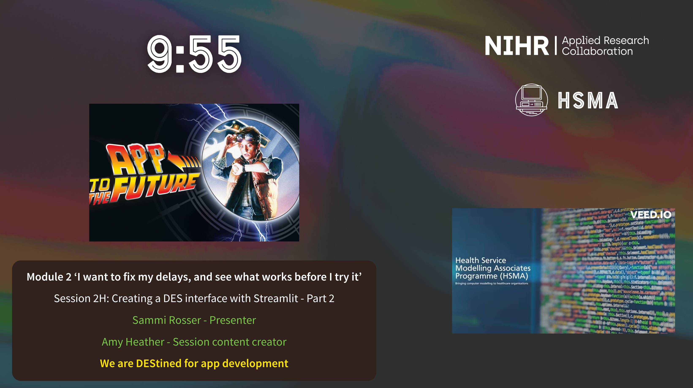
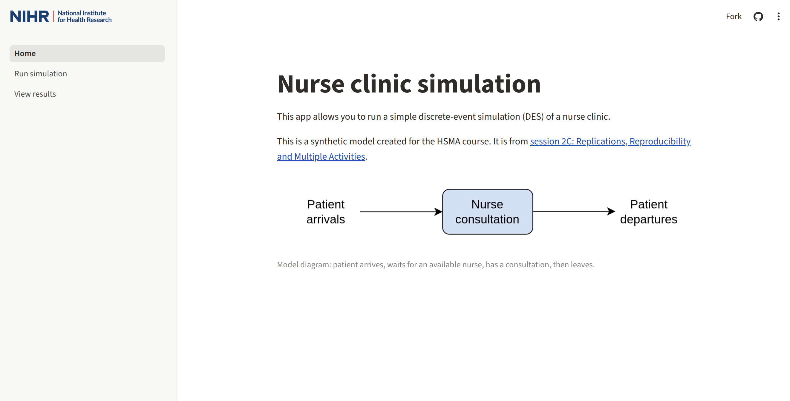

## Slides

:::: {.resource-card}

::: {.resource-actions}
[Open slides](slides/slides.qmd){.btn .btn-info}
:::

{fig-alt="Preview of the slides"}

::::

## Example app

:::: {.resource-card}

::: {.resource-actions}
[Run in browser](app/index.html){.btn .btn-info}
[Open cloud app](https://hsma-des-scenarios.streamlit.app/){.btn .btn-primary}
:::

{fig-alt="Preview of the app"}

::::
