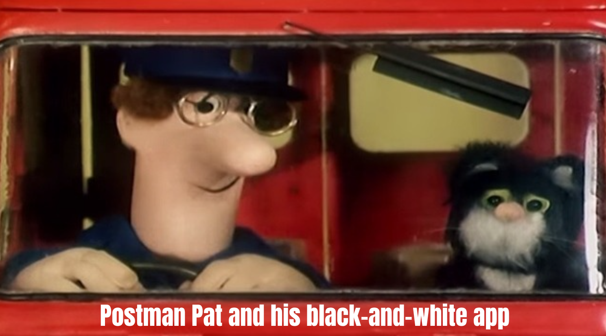

## 

<audio
  controls
  data-autoplay
  preload="auto"
  src="https://github.com/hsma-programme/hsma_assets/raw/refs/heads/main/h6_theme.mp3">
</audio>

:::: {.columns}

::: {.column width="55%"}

{height=250px}

::: {style="font-size: 21px; background-color: #31211d; border-radius: 16px; padding: 5px 0px;"}

**Module 2 'I want to fix my delays, and see what works before I try it'**

Session 2H: Creating a DES interface with Streamlit - Part 2

[Sammi Rosser - Presenter]{style="color: #7ac943;"}

[Amy Heather - Session content creator]{style="color: #7ac943;"}

[**We are DEStined for app development**]{style="color: #ffe600;"}

:::

:::

::: {.column width="10%"}

:::

::: {.column width="35%"}

{width=300px}

{width=200px}

   

<iframe
  data-src="https://www.youtube.com/embed/AExH1e6SvZA?autoplay=1&mute=1&controls=0&loop=1&playlist=AExH1e6SvZA&enablejsapi=1"
  data-autoplay
  style="display: block; width: 100%; aspect-ratio: 16 / 9; border: 0;"
  allow="autoplay; encrypted-media; fullscreen"
  allowfullscreen>
</iframe>

:::

::::

# Scenarios

now going to show how to make an app that can compare scenarios

need to be able to save results of a run

and then compare between them

to do this, we're going to split the simulation page into two

one that runs scenarios

one that can look at results of a scenario or compare them

## split

show splitting the two

## run and save scenarios

save how? session state

can do a success message, it saved yay

## show scenarios

help user keep track
show scenarios table

## results

results

single scenario or compare

st.tabs

## single scenario results

its same results code as before
just need to choose from scenarios
let user choose
can use a dropdown

## single scenario results

can remind of scenarios again with dataframe
can use pd.styler to highlight which they chose

## compare scenarios

need to run at least two
do message for that

## choose which to compare

choose which scenarios to compare
can use multiselect

## show chosen

can do the table again with pd.styler

## comparison figure

good for comparison is often boxplot
here also showing individual rep on boxplot

## comparison table

could also compare those summary stats in a table
and the staffing costs

## exercise

change app from yesterday from singlepage to multipage
with scenario comparison

## DAY TWO MORNING/AFTERNOON : SECTION 5 HOSTING WITH ST LITE

st lite

## exercise

host your app with stlite

## DAY TWO AFTERNOON : SECTION 6 CUSTOMISING APP APPEARANCE

theme

css

logo

etc.

st.set_page_config

st.logo

## exercise

customise appearance of your app
