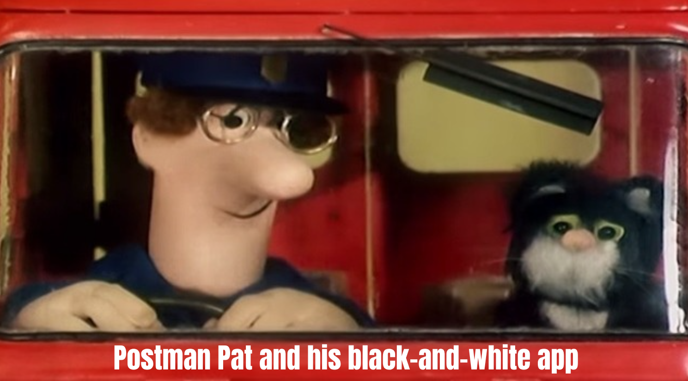

## 

<audio
  controls
  data-autoplay
  preload="auto"
  src="https://github.com/hsma-programme/hsma_assets/raw/refs/heads/main/h6_theme.mp3">
</audio>

:::: {.columns}

::: {.column width="55%"}

{height=250px}

::: {style="font-size: 21px; background-color: #31211d; border-radius: 16px; padding: 5px 0px;"}

**Module 2 'I want to fix my delays, and see what works before I try it'**

Session 2H: Creating a DES interface with Streamlit - Part 2

[Sammi Rosser - Presenter]{style="color: #7ac943;"}

[Amy Heather - Session content creator]{style="color: #7ac943;"}

[**We are DEStined for app development**]{style="color: #ffe600;"}

:::

:::

::: {.column width="10%"}

:::

::: {.column width="35%"}

{width=300px}

{width=200px}

   

<iframe
  data-src="https://www.youtube.com/embed/AExH1e6SvZA?autoplay=1&mute=1&controls=0&loop=1&playlist=AExH1e6SvZA&enablejsapi=1"
  data-autoplay
  style="display: block; width: 100%; aspect-ratio: 16 / 9; border: 0;"
  allow="autoplay; encrypted-media; fullscreen"
  allowfullscreen>
</iframe>

:::

::::