---
format:
  revealjs:
    css: styles.css
metadata-files:
  - template/slides.yml
filters:
  - value-box
---

## 

<audio
  controls
  data-autoplay
  preload="auto"
  src="https://github.com/hsma-programme/hsma_assets/raw/refs/heads/main/h6_theme.mp3">
</audio>

:::: {.columns}

::: {.column width="55%"}

<div class="hsma-countdown"></div>

{height=250px}

::: {style="font-size: 21px; background-color: #31211d; border-radius: 16px; padding: 5px 0px;"}

**Module 2 'I want to fix my delays, and see what works before I try it'**

Session 2H: Creating a DES interface with Streamlit - Part 2

[Sammi Rosser - Presenter]{style="color: #7ac943;"}

[Amy Heather - Session content creator]{style="color: #7ac943;"}

[**And they all lived APPily every after**]{style="color: #ffe600;"}

:::

:::

::: {.column width="10%"}

:::

::: {.column width="35%"}

{width=300px}

{width=200px}

<br><br><br>

<iframe
  data-src="https://www.youtube.com/embed/AExH1e6SvZA?autoplay=1&mute=1&controls=0&loop=1&playlist=AExH1e6SvZA&enablejsapi=1"
  data-autoplay
  style="display: block; width: 100%; aspect-ratio: 16 / 9; border: 0;"
  allow="autoplay; encrypted-media; fullscreen"
  allowfullscreen>
</iframe>

:::

::::


## Reminder: App from the last session

<iframe
  src="https://hsma-des-multipage.streamlit.app/?embed=true"
  style="width: 100%; flex: 1; min-height: 0; border: 0;"
></iframe>


## Reminder: App from the last session

<a href="https://hsma-programme.github.io/hsma7_2g_streamlit_part1/app/multipage/" target="_blank">View stlite app in new tab</a>


# Scenarios


## Adding scenarios to our app

:::: {.columns}

::: {.column width="55%"}

<br>

A common use for a DES app is to compare scenarios with different inputs.

Our current app shows results for one run at a time. Changing the inputs and running again replaces the previous results.

:::

::: {.column width="5%"}

:::

::: {.column width="40%"}


:::

::::

::: {.fragment}

To compare scenarios, we need to:

1. **Save** each run's inputs and results.
2. Allow users to **view and compare** saved scenarios.

:::


## Preview: the app we will create

<iframe
  src="https://hsma-des-scenarios.streamlit.app/?embed=true"
  style="width: 100%; flex: 1; min-height: 0; border: 0;"
></iframe>


## Preview: the app we will create

<a href="https://hsma-programme.github.io/hsma7_2h_streamlit_part2/app/" target="_blank">View stlite app in new tab</a>


## Two pages: run scenarios and explore results

As shown, our app now splits the original simulation page into two:

* **Run simulation:** set inputs and run the model.
* **View results:** view results from a saved scenario or compare several.

<br>

::: {.fragment}

**Why?**

These pages support two different tasks: setting up simulations and making sense of their results. Users can move between them without having to do both in the same place.

This keeps the interface manageable if we add more inputs, results and comparison features.

:::


## New dictionary in session state

We first create an empty dictionary in session state, ready to store scenario results.

```{.python}

```

<br>

::: {.fragment}

We need to make sure it is only created it if it doesn't already exist.

This is because Streamlit reruns the script when users interact with the app. Without this check, each rerun would replace the dictionary with an empty one, clearing any saved results.

```{.python code-line-numbers="1"}

```

:::


## New dictionary in session state

:::: {.columns}

::: {.column width="50%"}

We'll initialise the dictionary in `app.py`, which runs before whichever page the user opens.

<br>

**Why not in `simulation.py?`**

Users might open the results page before running a simulation. If we created the dictionary only in `simulation.py`, it wouldn't exist yet, causing an error.

Putting this code in `app.py` ensures the dictionary exists before either page needs it.

:::

::: {.column width="50%"}

```{.python code-line-numbers="5-7"}

```

:::

::::


## Run and save the results

:::: {.columns}

::: {.column width="50%"}

In `simulation.py`, we'll keep the code that sets the inputs and runs the simulation.

We'll remove the analysis code for now and move it to the results page later. We can also remove `import plotly.express as px` as this page no longer uses it.

<br>

We'll add new code to:

1. Name the scenario

2. Save its settings and results in `st.session_state.scenarios`.

:::

::: {.column width="50%"}

```{.python code-line-numbers="92,109-130"}


```

:::

::::


## Run and save the results

:::: {.columns}

::: {.column width="50%"}

**Scenario names** are based on how many scenarios are already stored (e.g., "Scenario 1", "Scenario 2").

<br>

**Settings** record the inputs used for each scenario, so we can interpret and compare its results.

**Results** are the summary statistics, saved using shorter keys like `mean` and `sd` so they are easier to access later.

:::

::: {.column width="50%"}

```{.python}

```

:::

::::


## Run and save the results

We then set `chosen_scenario` to this scenario, making it the default selection when the user opens the results page.

We also show a success message to confirm that the scenario has run and its results have been saved.

<br>

```{.python}

```


## Keeping track of scenarios

We can also show a table of saved scenarios, so users can keep track of their runs.

This checks if `scenarios` is empty - and will only appear after the first scenario has been run.

We take the settings from each saved scenario and display them as a row in the table.

A caption reminds users that these scenarios are saved for the current session only.

<br>

```{.python}

```


## `st.divider()`

You may've noticed we used a new Streamlit element here - `st.divider()`.

This displays a horizontal line on the app.

<br>

```{.python code-line-numbers="2"}

```


## Linking to results page

At the end of `simulation.py`, we'll add a button linking to `results.py`, which we'll create next.

Clicking the button calls `st.switch_page` to take the user to the results page.

<br>

```{.python code-line-numbers="false"}

```


## Results from one scenario

:::: {.columns}

::: {.column width="50%"}

<br>

Now let's make the results page!

<br>

We'll start by moving the analysis code we removed earlier into a new file, `results.py`.

You can that code on the right.

<br>

However, we'll need to make some changes so it can work...

:::

::: {.column width="50%"}

```{.python code-line-numbers="false"}

```

:::

::::


## Required changes

:::: {.columns}

::: {.column width="50%"}

<br><br>

**1. Import the packages**

Import `pandas`, `plotly.express` and `streamlit` for this page.

:::

::: {.column width="50%"}

```{.python code-line-numbers="1-3"}

```

:::

::::


## Required changes

:::: {.columns}

::: {.column width="50%"}

<br><br>

**2. Retrieve the chosen scenario**

Use `chosen_scenario` to look up the saved scenario in `scenarios` and store it as `results`.

<br>

*For now, this is the most recently run scenario. We'll add a way for users to choose a different scenario in a moment.*

:::

::: {.column width="50%"}

```{.python code-line-numbers="5-6"}

```

:::

::::


## Required changes

:::: {.columns}

::: {.column width="50%"}

<br><br>

**3. Display the saved results**

Read the summary statistics and cost from `results`, rather than directly from the simulation `trial` object.

:::

::: {.column width="50%"}

```{.python code-line-numbers="13-21"}

```

:::

::::


## Required changes

:::: {.columns}

::: {.column width="50%"}

<br><br>
**4. Use saved data in histogram and table**

Use `results["df"]` as the data source for both the histogram and the table of individual replications.

:::

::: {.column width="50%"}

```{.python code-line-numbers="29,40"}

```

:::

::::


## Choose a scenario

Now we can let users choosen their `chosen_scenario` to view.

:::: {.columns}

::: {.column width="50%"}
We'll add:

* A dropdown to select a saved scenario.
* A table of scenario settings, so users can see what they're choosing between.
* A highlighted row showing the selected scenario.
:::

::: {.column width="50%"}

:::

::::


## Choose a scenario

:::: {.columns}

::: {.column width="50%"}

Let's work through the code to do that...

:::

::: {.column width="50%"}

```{.python}

```

:::

::::


## Choose a scenario

:::: {.columns}

::: {.column width="50%"}

<br><br>

**1. Use `st.container(border=True)`**

This keeps the scenario selection area visually separate from the results.

:::

::: {.column width="50%"}

```{.python code-line-numbers="1"}

```

:::

::::


## Choose a scenario

:::: {.columns}

::: {.column width="50%"}
<br><br>

**2. Select a scenario**

Use `st.selectbox()` to create a dropdown with the names of save scenarios.

Using `key="chosen_scenario"` means the selection is saved as and overwrites the last `chosen_scenario` in session state.

:::

::: {.column width="50%"}

```{.python code-line-numbers="2-6"}

```

:::

::::


## Choose a scenario

:::: {.columns}

::: {.column width="50%"}

<br><br>

**3. Create a settings dataframe**

Extract the settings dictionary for each saved scenario and combined them into a dataframe, with one row per scenario.

:::

::: {.column width="50%"}

```{.python code-line-numbers="8-14"}

```

:::

::::


## Choose a scenario

:::: {.columns}

::: {.column width="50%"}

<br><br>

**4. Display the settings dataframe**

Use `st.dataframe()` to display `settings`.

We'll write a function `style_settings()` which we can apply to the dataframe to highlight the chosen scenario row...

:::

::: {.column width="50%"}

```{.python code-line-numbers="16-24"}

```

:::

::::


## `style_settings()`

We'll write this function near the start of our `results.py` script.

It checks each row's scenario name against `chosen_scenarios`. Matching rows get a pale blue background. We use `.style.apply()` to apply this formatting row by row, then `.format(precision=2)` to display decimal values to two decimal places.

```{.python}

```


## No scenarios to view

Users might open the results page before running a scenario.

We'll show a message explaining that there are no saved results yet and directing them to run a scenario first.


## No scenarios to view

:::: {.columns}

::: {.column width="50%"}

We first check whether `scenarios` is empty.

If it is, we show a message using `st.info()`.

Otherwise, we display the results page as before.

:::

::: {.column width="50%"}

```{.python code-line-numbers="1-4"}

```

:::

::::

<br>

This avoids trying to display results when none are available.


## Creating tabs

:::: {.columns}

::: {.column width="50%"}

<br><br>

We have now finished the code for displaying results from one chosen scenario. Next, we'll add a way to compare several scenarios.

<br>

We'll use `st.tabs` to organise these two tasks within the results page:

* **View single scenario**
* **Compare scenarios**

:::

::: {.column width="50%"}

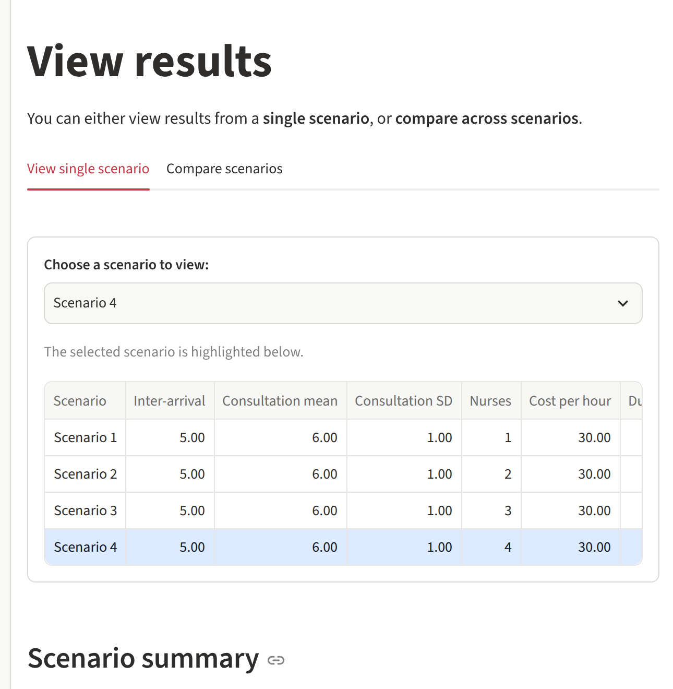

:::

::::


## Creating tabs

:::: {.columns}

::: {.column width="40%"}

We pass `st.tabs()` a list with titles for each tab.

<br>

It returns a container for each tab, which we assign to variables (here, `tab_single` and `tab_compare`).

<br>

We then use a `with` block to add content to each tab.

:::

::: {.column width="60%"}

```{.python code-line-numbers="11-15"}

```

:::

::::


## Choosing scenarios to compare

:::: {.columns}

::: {.column width="50%"}

<br><br><br>

On the “Compare scenarios” tab, we'll add a selection box where users can choose multiple saved scenarios.

If fewer than two scenario are run or selected, we'll show a messages asking them to run or select at least two.

:::

::: {.column width="50%"}

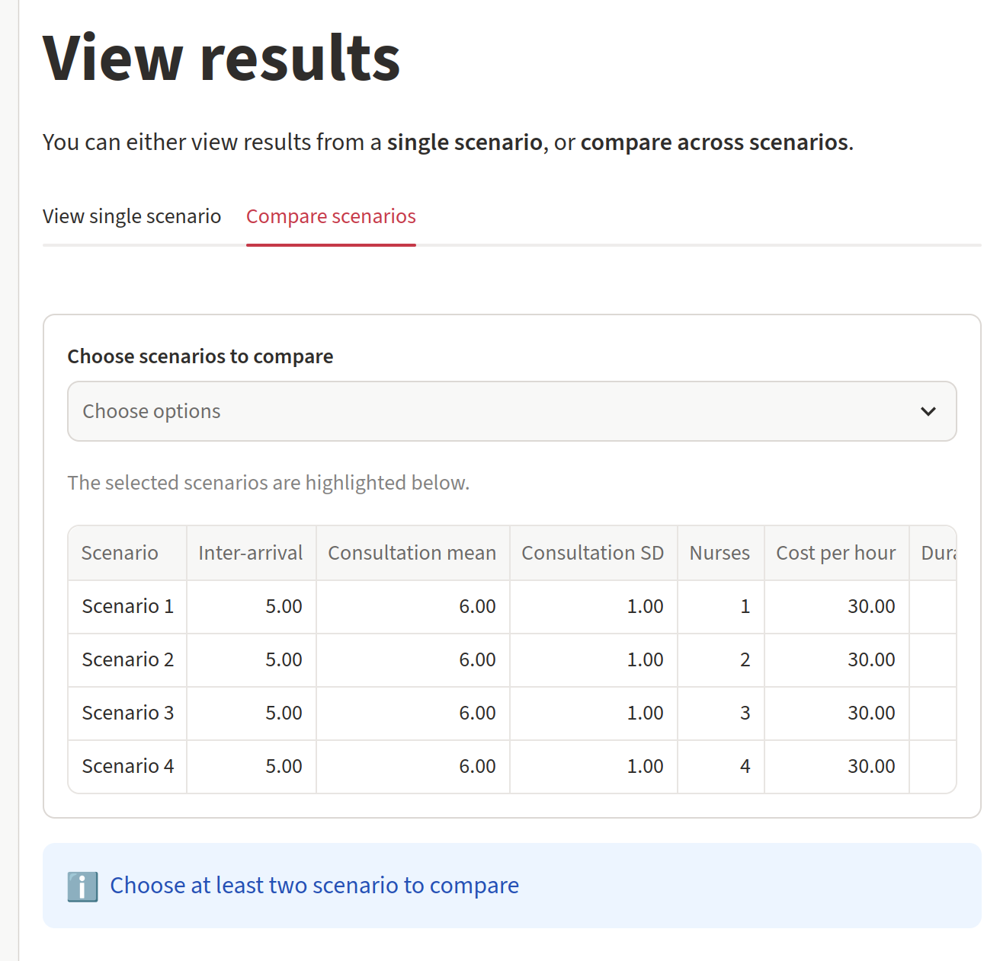

:::

::::


## Choosing scenarios to compare

:::: {.columns}

::: {.column width="50%"}

Let's work through the code to do that...

:::

::: {.column width="50%"}

```{.python}

```

:::

::::


## Choosing scenarios to compare

:::: {.columns}

::: {.column width="50%"}

<br><br>

**1. Use `tab_compare` and warn for insufficient scenarios**

If `scenarios` in session state only has zero or one saved scenarios, a message is displayed using `st.info()`.

:::

::: {.column width="50%"}

```{.python code-line-numbers="1-3"}

```

:::

::::


## Choosing scenarios to compare

:::: {.columns}

::: {.column width="50%"}

<br><br>

**2. Multiselect**

Once there are at least two scenarios, we set up a container and create `st.multiselect()`.

This is similar to `selectbox`, but allows users to choose multiple options at once.

:::

::: {.column width="50%"}

```{.python code-line-numbers="5-11"}

```

:::

::::


## Choosing scenarios to compare

:::: {.columns}

::: {.column width="50%"}

<br><br>

**3. Show saved scenarios**

Like before, we can show the saved scenarios and highlighted those selected using `style_settings()`.

:::

::: {.column width="50%"}

```{.python code-line-numbers="13-18"}

```

:::

::::


## Choosing scenarios to compare

:::: {.columns}

::: {.column width="50%"}

<br><br>

**4. Check chosen scenarios**

Show a message until at least two scenarios have been chosen. Then, results can be shown.

:::

::: {.column width="50%"}

```{.python code-line-numbers="20-24"}

```

:::

::::


## Boxplot

:::: {.columns}

::: {.column width="35%"}

<br><br><br><br>

Boxplots are a great option for comparing results across scenarios side by side.

They make it easy to see both the average results and the spread of results across replications.

:::

::: {.column width="65%"}


:::

::::


## Boxplot

:::: {.columns}

::: {.column width="50%"}

<br><br>

**1. Introduce figure**

We'll start by using `st.subheader()` and `st.write()` to introduce the figure and explain what it is showing.

:::

::: {.column width="50%"}

```{.python code-line-numbers="1-5"}

```

:::

::::


## Boxplot

:::: {.columns}

::: {.column width="50%"}

<br><br>

**2. Create single results dataframe**

Next, we use `pd.concat()` to stack the replication-level results from each scenario into a single dataframe called `replications`.

We also add a `Scenario` column to identify which scenario each row belongs to.

:::

::: {.column width="50%"}

```{.python code-line-numbers="7-14"}

```

:::

::::


## Boxplot

:::: {.columns}

::: {.column width="50%"}

**3. Create boxplot**

We create the figure using `plotly.express.box()`:

* `color`: group and color by scenario.
* `points`: show each replication as a dot.
* `category_orders`: keeps scenarios in the order they were saved.
* `hover_data`: include replication IDs.

It's displayed with `st.plotly_chart()`.

:::

::: {.column width="50%"}

```{.python code-line-numbers="16-32"}

```

:::

::::


## Comparison table

We could also use tables to compare results.

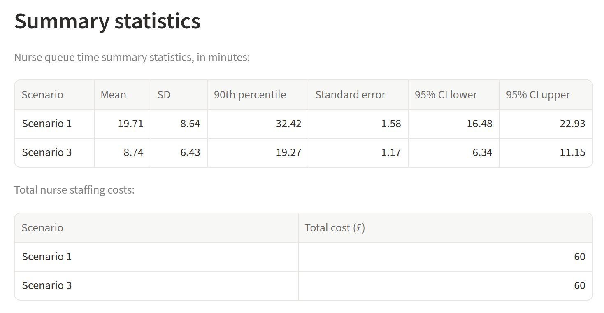{height=450px}


## Comparison table

:::: {.columns}

::: {.column width="50%"}

<br><br>

**1. Construct summary table for nurse queue time**

Here, we are creating a table with the descriptive statistics from each scenario.

:::

::: {.column width="50%"}

```{.python code-line-numbers="4-21"}

```

:::

::::


## Comparison table

:::: {.columns}

::: {.column width="50%"}

<br><br>

**2. Display summary table**

We then display it using `st.dataframe()`, with `style.format()` to round the numbers.

`st.caption()` provides some helpful context.

:::

::: {.column width="50%"}

```{.python code-line-numbers="23-28"}

```

:::

::::


## Comparison table

:::: {.columns}

::: {.column width="50%"}

<br><br>

**3. Repeat for costs**

We can repeat this to show the nurse costs for each scenario. These are deterministic, just based on the number of resources in the simulation, so a single number is presented for each scenario.

:::

::: {.column width="50%"}

```{.python code-line-numbers="30-42"}

```

:::

::::


# Exercise 1


## Exercise 1

:::: {.columns}

::: {.column width="55%"}

Adapt the app you created in the last session so users can save and compare scenarios.

Create two separate pages:

* `simulation.py`: run the simulation and save each scenario's settings and results.
* `results.py`: view results for one saved scenario or compare results across multiple scenarios.

Use session state to make saved scenarios available on both pages.

:::

::: {.column width="5%"}

:::

::: {.column width="40%"}

::: {style="display: flex; justify-content: flex-end;"}
::: {.value-box icon="fa-solid fa-clock" icon-position="left" icon-size="2em" min-height="0" padding="0.4rem 1rem" width="350px"}
?? minutes + ?? minute break
:::
:::

::: {style="font-size: 80%"}

> **Extensions**
> 
> * Add a selector to choose which outcome to compare in the boxplot.
> * Let users delete saved scenarios.
> * Highlight which settings differ between selected scenarios.
> * Let users add a short optional note describing each scenario.

:::

:::

::::


# stlite


## Reminder: Streamlit Community Cloud

In the last session, we introduced Streamlit Community Cloud.

It was an easy  way to deploy from GitHub, with automatic updates when you push changes.

However, apps share limited server resources and go to sleep after 12 hours without visitors. 


## stlite

An alternative is **stlite**, which runs Python directly in the user's browser. Instead of sending requests to a server to run your code, the user's own device does the work.

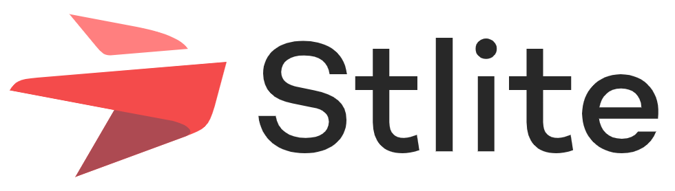


## How does stlite work?

:::: {.columns}

::: {.column width="85%"}

A browser can display your app, but can't normally run its Python code. Browsers usually use **JavaScript**, a programming language designed for web pages.

:::

::: {.column width="15%"}

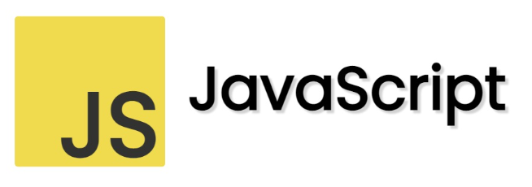{height=70px}

:::

::::

::::: {.fragment}

:::: {.columns}

::: {.column width="85%"}

In 2017, **WebAssembly (Wasm)** was released. It allows browsers to run compiled code alongside JavaScript, including software they wouldn't normally support.

:::

::: {.column width="15%"}

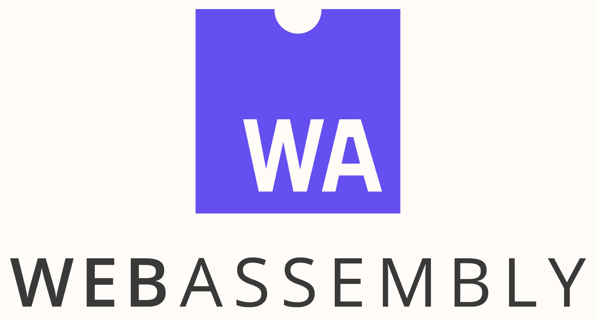{height=70px}

:::

::::

:::::

::::: {.fragment}

:::: {.columns}

::: {.column width="85%"}

**Pyodide** uses WebAssembly to provide a Python environment. It includes an interpreter (which reads and runs Python code) and support for packages.

:::

::: {.column width="15%"}

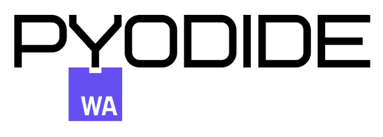{height=70px}

:::

::::

:::::

::::: {.fragment}

:::: {.columns}

::: {.column width="85%"}

stlite uses this environment to run your Streamlit app on the user's device.

:::

::: {.column width="15%"}

{height=70px}

:::

::::

:::::


## stlite: pros and cons

:::: {.columns}

::: {.column width="50%"}

**Pros:**

* No server to wake up.
* No external resource limits, can cope with concurrent users.
* Data doesn't leave the user's browser.
* Host for free with GitHub Pages.

:::

::: {.column .fragment width="50%"}

**Cons:**

* Initial loading can take longer while Python and packages download.
* Slower to run (as depends on the user's device).
* Not all Python packages and Streamlit features are supported.
* Set-up is not as easy as Streamlit Community Cloud.
* Browser caching can leave users seeing an older version of the app.

:::

::::


## Running a Streamlit app with stlite

:::: {.columns}

::: {.column width="50%"}

To use stlite, we add an `index.html` file to our app folder. HTML defines the structure and content of a web page. This file loads stlite and tells it how to launch our app.

<br>

We can reuse a standard template, changing a few details for our app.

Let's work through the `index.html` used to deploy the scenario app.

:::

::: {.column width="50%"}

```{.html}

```

:::

::::


## Running a Streamlit app with stlite

:::: {.columns}

::: {.column width="50%"}

<br>

The highlighted lines provide the standard page structure and can stay the same between apps.

* `<head>` contains page settings and loads stlite's stylesheet and JavaScript.
* `<body>` contains the page content, including our app.

The closing tags at the end mark where the app, page body and HTML document finish.

:::

::: {.column width="50%"}

```{.html code-line-numbers="1-5,7-10,26-28"}

```

:::

::::


## Running a Streamlit app with stlite

:::: {.columns}

::: {.column width="50%"}

Having said that, you'll notice these are pinned to a particular version of stlite: `@stlite/browser@1.12.2`.

If a new version is released since the development of these slides, you may wish to upgrade to that - you can see the latest version in the stlite GitHub releases: <https://github.com/whitphx/stlite/releases>.

stlite recommend pinning to a version as they say their API may change without backwards compatability in future releases.

:::

::: {.column width="50%"}

```{.html code-line-numbers="7-8"}

```

:::

::::


## Running a Streamlit app with stlite

:::: {.columns}

::: {.column width="50%"}

<br>

Moving on, these are things you'll want to amend for your own app...

<br>

`<title>` sets the browser tab's initial title.

The app replaces this once it loads, so it only appears briefly.

:::

::: {.column width="50%"}

```{.html code-line-numbers="6"}

```

:::

::::


## Running a Streamlit app with stlite

:::: {.columns}

::: {.column width="50%"}

<br><br>

`<streamlit-app>` specifies the entrypoint file.

`<app-file>` identifies all other files required by the app - including Python files, images, and other file types.=

:::

::: {.column width="50%"}

```{.html code-line-numbers="11-19"}

```

:::

::::


## Running a Streamlit app with stlite

:::: {.columns}

::: {.column width="50%"}

<br>

`<app-requirements>` lists the Python packages to install.

We pin `simpy` and `sim-tools` to the versions used to develop the app. We leave `numpy` and `pandas` unpinned so Pyodide can use its compatible versions.

<br>

We don't include `streamlit` as stlite provides it.

:::

::: {.column width="50%"}

```{.html code-line-numbers="20-25"}

```

:::

::::


## Streamlit versions in stlite

:::: {.columns}

::: {.column width="50%"}

stlite includes a modified version of Streamlit, adapted to run in the browser. This is why we do not add `streamlit` to `<app-requirements>`.

::: {.fragment}
The stlite developers periodically update this version to the latest version of Streamlit, but may not always be up-to-date. New Streamlit features may therefore not be available immediately in stlite. Check the [stlite release notes](https://github.com/whitphx/stlite/releases), and test your app before upgrading.
:::

::: {.fragment}
**Each stlite release is pinned to a particular version of streamlit**. For example, stlite `1.12.2` includes a build based on Streamlit `1.65.0`.
:::

:::

::: {.column width="50%"}


:::

::::


## Finding which streamlit version is in use


:::: {.columns}

::: {.column width="45%"}

Via GitHub:

1. Open the [stlite release you are using on GitHub](https://github.com/whitphx/stlite/tree/%40stlite/browser%401.12.2).
2. Click the `streamlit` submodule link (e.g., `streamlit @ 9c524f4`). This opens the exact Streamlit source code included in that release.
3. Open `lib/pyproject.toml` and find `version` under `[project]`.

:::

::: {.column width="10%"}
:::

::: {.column width="45%"}

::: {.fragment}

Alternatively, run your app using your chosen stlite version and include this command to see which Streamlit build it uses:

```{.python}
st.write("Streamlit version:", st.__version__)
```

:::

:::

::::


##  Try out the stlite app locally

`index.html` serves as the website's starting page. To view the app locally, open a terminal in the folder containing `index.html` and run:

```bash
python -m http.server 8000
```

Then open `http://localhost:8000` in your browser. This lets us test the app on our own computer.

To share it with others through a web address, we need to host its files online. GitHub Pages can host `index.html` and the other files our app needs. When someone visits the website, their browser downloads these files and runs the app using stlite.


# Hosting an stlite app on GitHub Pages

## GitHub Pages

:::: {.columns width="50%"}

::: {.column}

<br><br>

GitHub Pages is a website hosting service. It takes HTML, CSS, and JavaScript files from your GitHub repository and publishes them as a website.

<br>

It is **free** to use with public repositories.

It is **easy** to set up because it integrates directly with your GitHub repository.

:::

::: {.column width="50%"}


:::

::::


## Enabling GitHub Pages

:::: {.columns}

::: {.column width="70%"}

<br><br>

The first step for setting up our stlite app website is to enable GitHub Pages.

From your GitHub repository, click on "Settings" and then in the sidebar click on "Pages".

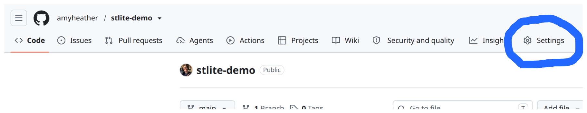

:::

::: {.column width="20%"}

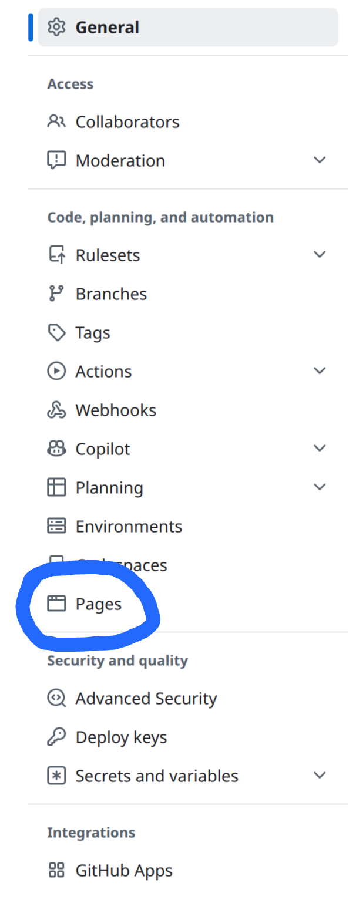

:::

::::


## Enabling GitHub Pages

Under Source, select `Deploy from a branch` (if not already selected).

Then select `main` and `/ (root)` and click `Save`.

It should now say your site is "currently being built from the `main` branch".

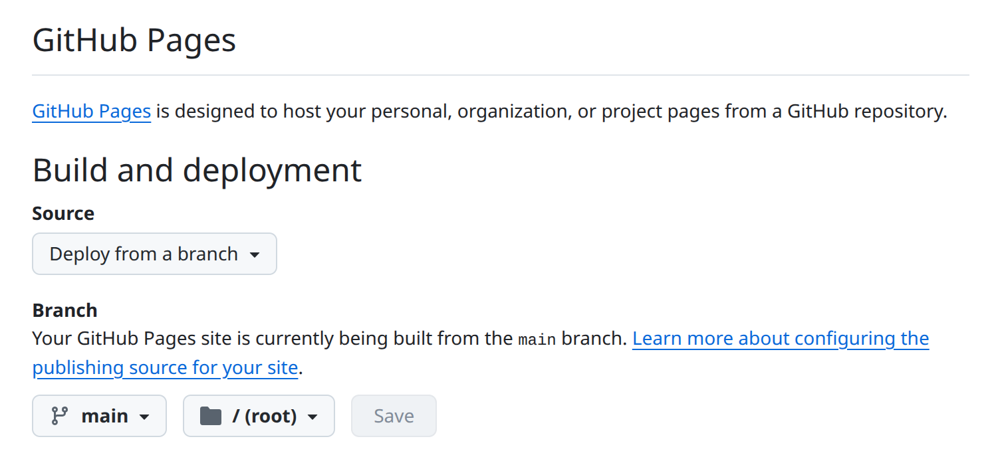{height=320px}


## Deployed site

Your app should now be live on GitHub Pages. Click the `github-pages` deployment in your repository's right sidebar to view the deployment details and website link.

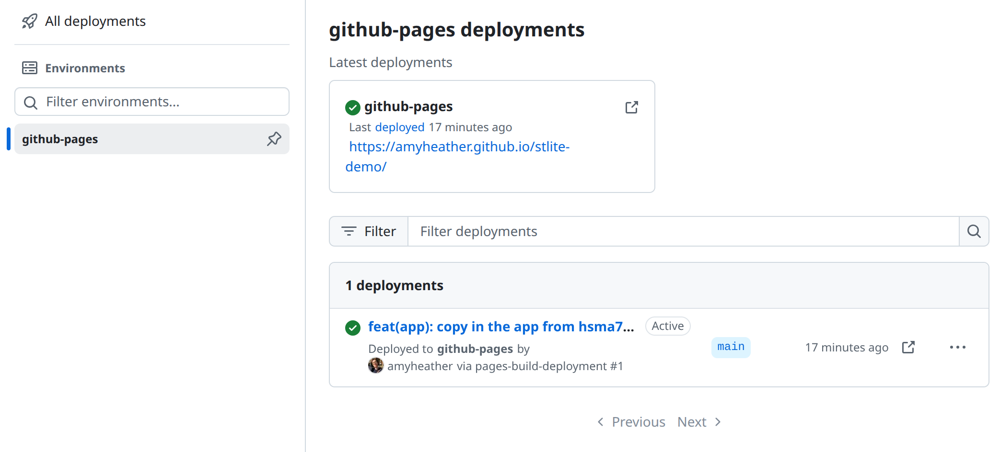{height=400px}


## Add link to repository home

We'd recommend adding this link to your repository `README`.

You can also add it to the "About" panel by clicking the "⚙" symbol in the right sidebar, then clicking "Use your GitHub Pages website" and then "Save changes".

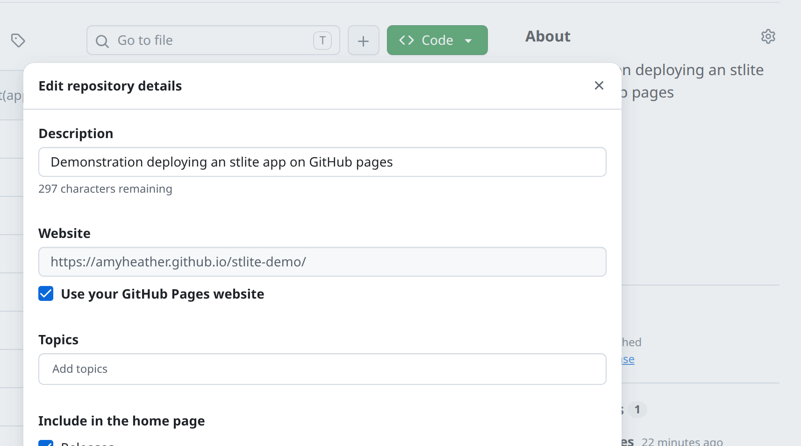{height=350px}


## File locations

These instructions assume your app files are in the repository root (the top-level folder).

This is why we selected `/ (root)` when setting up GitHub Pages.

For example:

```text
your-repository/
├── index.html
├── app.py
├── home.py
├── model.py
├── simulation.py
├── results.py
└── images/
    └── logo.png
```


## File locations

You can also organise your app files into subfolders.

If `index.html` stays in the root, the GitHub Pages settings stay the same. Just update the paths in `index.html` to match your file locations.

For example:

```{.text code-line-numbers="3-10"}
your-repository/
├── index.html
└── app/
    ├── app.py
    ├── home.py
    ├── model.py
    ├── simulation.py
    ├── results.py
    └── images/
        └── logo.png
```


## File locations

If you move `index.html` into a subfolder too, you have a few options:

<div style="margin-top: 1em; margin-bottom: 1em;">

| Location | What to do |
| - | --- |
| `docs/index.html` | Select `main` → `/docs` as the publishing source. |
| `app/index.html` | Publish the repository root and access the app at `https://USERNAME.github.io/REPOSITORY/app/`. |
| `app/index.html` | Use a GitHub Actions workflow to publisht the contents of `app/` |

</div>

For simplicity, we recommend keeping `index.html` in the repository root. The other files can be in subfolders - just make sure the paths in `index.html` match their locations.


# Other hosting options

## All aboard the Enterprise

:::: {.columns}

::: {.column width="60%"}

<br>

If you're lucky enough to be working in a progressive organisation, you may have access to a service like **Posit Connect**, **Plotly Dash Enterprise** or **Snowflake**.

:::

::: {.column width="40%"}

{height=200px}

:::

::::

These services massively simplify the deployment and hosting of Streamlit apps, along with a series of bells and whistles like permission management/user authentication support.

It usually means someone else has already dealt with (most of) the messy stuff around secure sharing of data.


## All aboard the Enterprise

:::: {.columns}

::: {.column width="50%"}

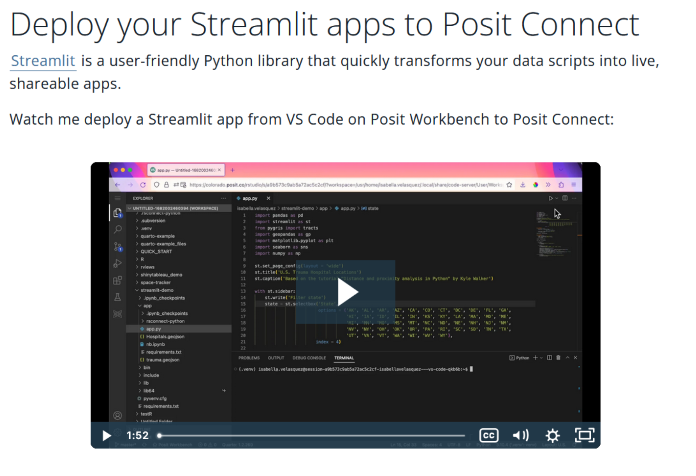

:::

::: {.column width="50%"}

For example, from Posit Connect, you can deploy Streamlit apps with just a few lines - as well as Shiny apps (in R or Python), Quarto documents (with scheduled refresh), Dash apps...

:::

::::


## Name your price

:::: {.columns}

::: {.column width="60%"}

Price - and/or the way pricing is calculated - can often be a barrier for organisations. 

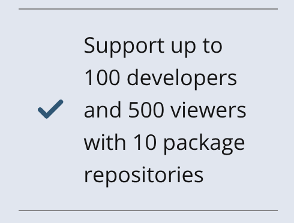{height=200px}

E.g., the "enhanced" tier of Posit Connect

However, the efficiency savings by working with a tool like this have the potential to be **huge**.

Posit in particular have some history of working with NHS organisations to make pricing available that will work.

:::

::: {.column width="10%"}
:::

::: {.column width="30%"}

> 
> 
> Anyone using these? Shout out or pop it in the chat!

:::

::::


# Customising app appearance


## Customising app appearance

There's lots of fun ways to change the appearance of your app!

We're going to touch on a few of the options available...


## `st.set_page_config`

This function configures the page's appearance. Set defaults in `app.py`, then override them on individual pages if needed. Key parameters include...

`page_title`: The title shown in the browser tab.

`page_icon`: The favicon, which is a small icon beside the browser tab's title. Use an image, emoji or Material Symbols icon.

:::: {.columns}

::: {.column width="50%"}

```{.python code-line-numbers="3-6"}

```

:::

::: {.column width="50%"}

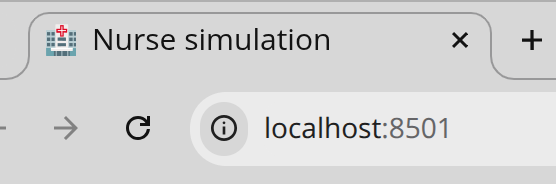

:::

::::


## `st.set_page_config`

`layout` decides whether the app constrains content to a centered column (default) or if it uses the available page width.

This is what an app looks like with `layout="centered"`.

:::: {.columns}

::: {.column width="40%"}

```{.python code-line-numbers="3-5"}

```

:::

::: {.column width="60%"}

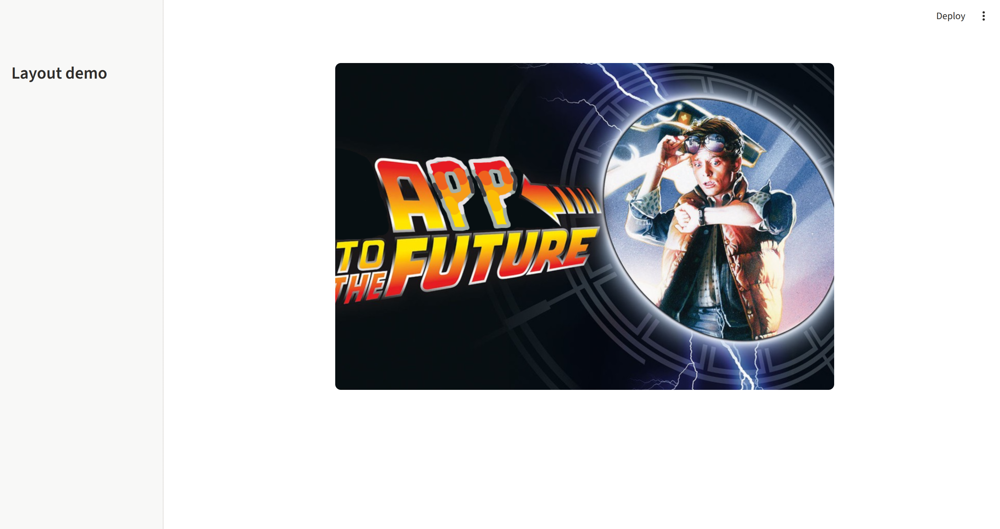

:::

::::


## `st.set_page_config`

`layout` decides whether the app constrains content to a centered column (default) or if it uses the available page width.

This is what an app looks like with `layout="wide"`.

:::: {.columns}

::: {.column width="40%"}

```{.python code-line-numbers="3-5"}

```

:::

::: {.column width="60%"}

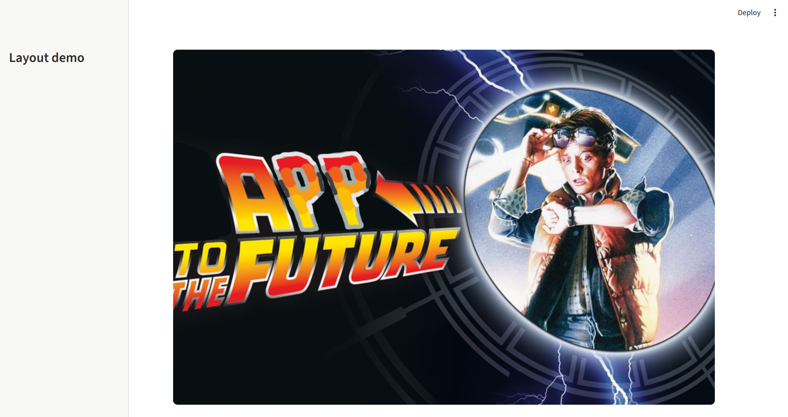

:::

::::


## `st.logo`

This command creates a logo in the app. You can provide a path to an image, or an emoji or material symbols icon. For example:

:::: {.columns}

::: {.column width="40%"}

```{.python code-line-numbers="3"}

```

:::

::: {.column width="60%"}

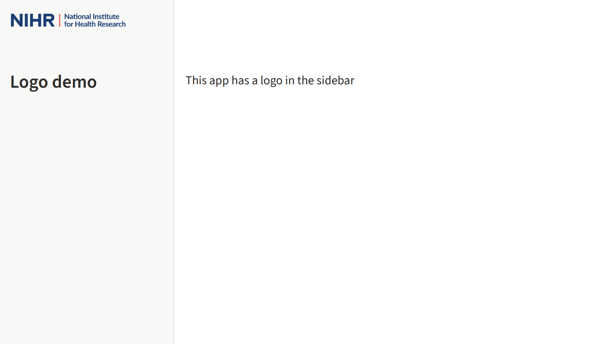

:::

::::


## `st.navigation`

When we set-up our multi-page app using `st.navigation`, it provided a navigation menu in a sidebar by default.

We can move the navigation menu to the top of the screen using `position="top"`. For example:

:::: {.columns}

::: {.column width="40%"}

<br>

```{.python code-line-numbers="8"}

```

:::

::: {.column width="60%"}

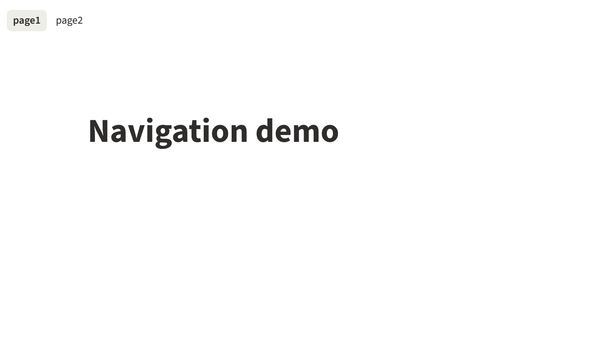

:::

::::


## `config.toml`

Create a `.streamlit` folder in your project folder, then add a `config.toml` file:

```text
your-app/
├── app.py
└── .streamlit/
    └── config.toml
```

This is a configuration file. It can control things like logging, error messages, and caching.

We'll focus now on using it to customise the app's theme.


## `config.toml` theme

:::: {.columns}

::: {.column width="60%"}

```{.toml}

```

:::

::: {.column width="40%"}

Define your theme settings under `[theme]`. There are lots of options - we have included a few of the main ones here.

Use `[theme.sidebar]` to override settings specifically for the sidebar.

You can also define separate light and dark themes using `[theme.light]` and `[theme.dark]`.

:::

::::


## `config.toml` theme: light

This is what the default light theme looks like.

:::: {.columns}

::: {.column width="45%"}

```{.toml}

```

:::

::: {.column width="55%"}

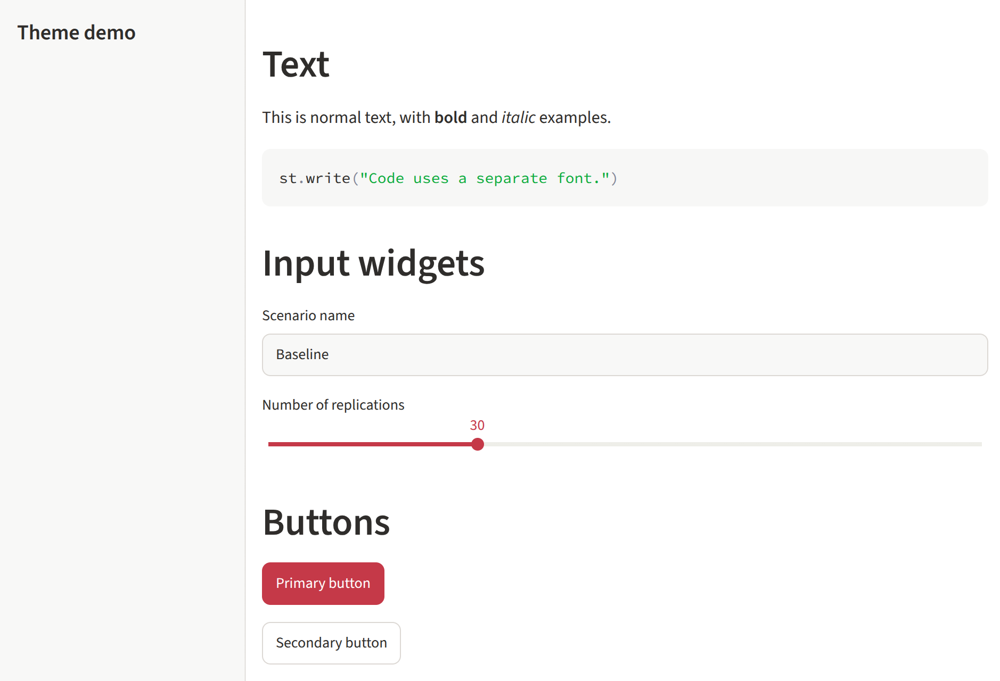

:::

::::


## `config.toml` theme: dark

This is what the default dark theme looks like.

:::: {.columns}

::: {.column width="45%"}

```{.toml}

```

:::

::: {.column width="55%"}

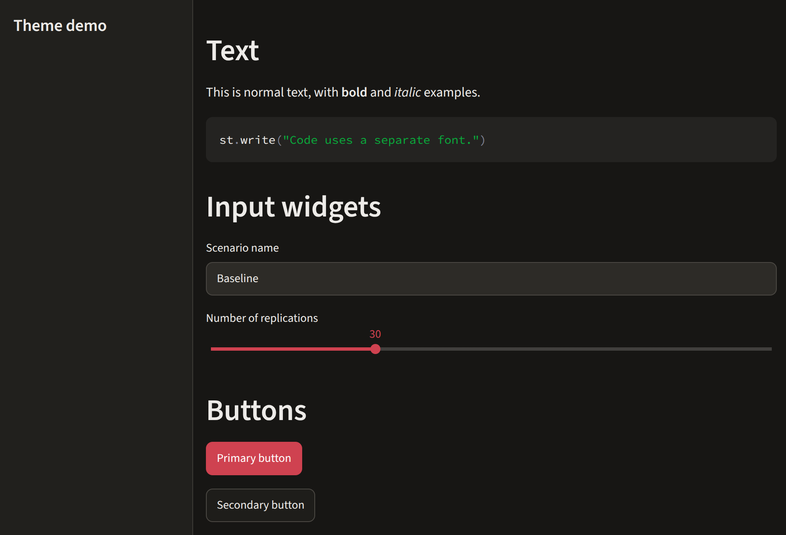

:::

::::


## `config.toml` theme: custom

This is an example of a custom theme.

:::: {.columns}

::: {.column width="45%"}

```{.toml}

```

:::

::: {.column width="55%"}

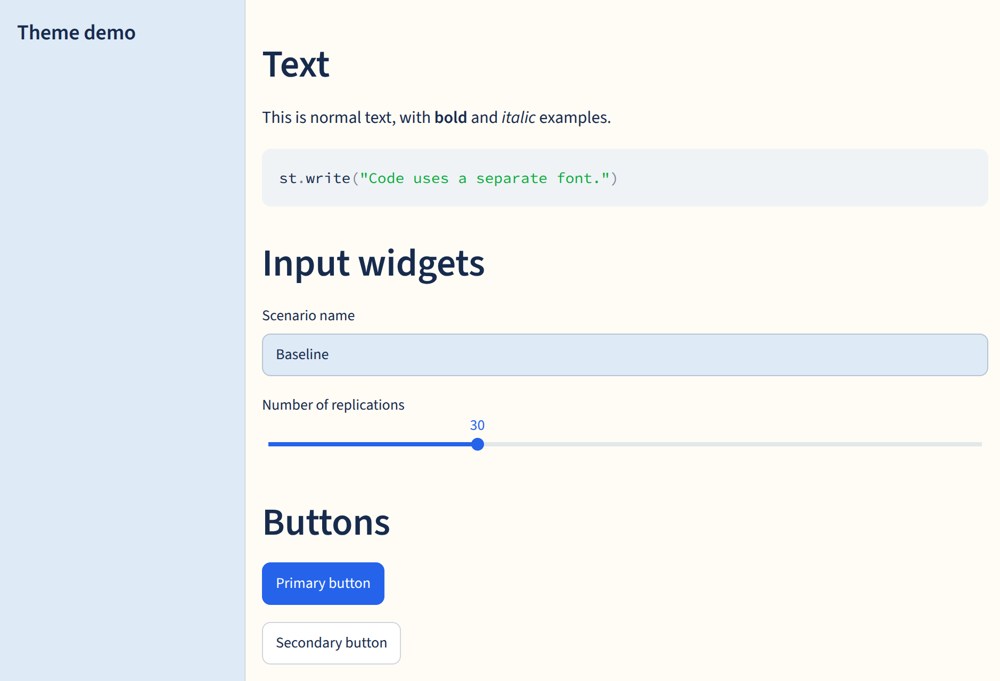

:::

::::


## CSS

For additional customisation, we can use CSS (Cascading Style Sheets). CSS is a language that controls how web content look.

Use config.toml for the overall theme, and Streamlit's built-in options wherever possible. CSS is useful for more specific styling that these options don't support.

We can write these styles in a `.css` file and load them into our app using `st.html()`.

```{.python}
import streamlit as st

with open("style.css") as css:
    st.html(f"<style>{css.read()}</style>")
```

Streamlit has introduced lots of new features over the last few years. You may find older tutorial using CSS, but those features are now supported directly by Streamlit, so it's always worth checking the current documentaiton.


# Exercise 2


## Exercise 2

:::: {.columns}

::: {.column width="45%"}

<br>

Deploy your app using stlite and GitHub pages.

Then customise your app. You could try:

* Setting `st.set_page_config`.
* Adding `st.logo()`.
* Moving navigation menu to top of screen.
* Adding `config.toml` with a custom theme.

Remember if add new files will need to add those to `index.html`.

:::

::: {.column width="5%"}

:::

::: {.column width="50%"}

::: {style="display: flex; justify-content: flex-end;"}
::: {.value-box icon="fa-solid fa-clock" icon-position="left" icon-size="2em" min-height="0" padding="0.4rem 1rem" width="350px"}
?? minutes + ?? minute break
:::
:::

::: {style="font-size: 80%"}

> **Extensions**
> 
> * .

:::

:::

::::

# Other streamlit features

## Other streamlit features

We've focused on the key features for building and sharing a DES app.

Streamlit has plenty more to offer, but we can't cover everything in these sessions.

We'll briefly highlight a few other features you might find useful.

See the [Streamlit documentation](https://docs.streamlit.io/develop/api-reference) for more examples and guidance.

[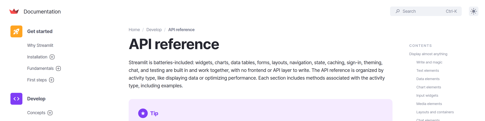](https://docs.streamlit.io/develop/api-reference)


## `st.metric()`

## `st.grid()`

## Fragments

## Caching

## User authentication

## Database linkage

## App testing

## Custom components

## `st.toast`

## `st.data_editor`

## Built-in streamlit charts

::: {.api-images}

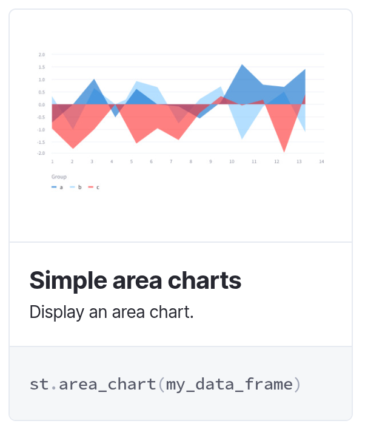
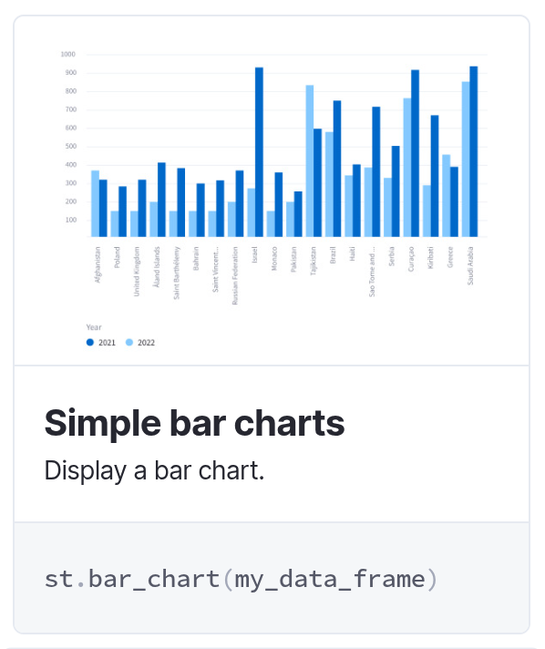
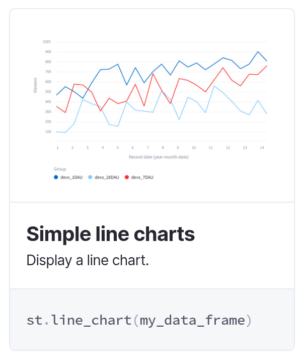
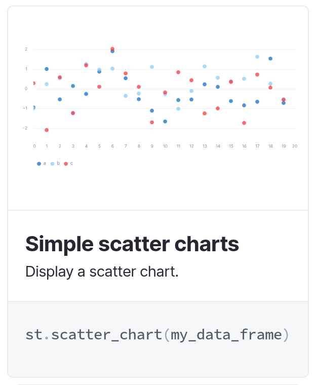
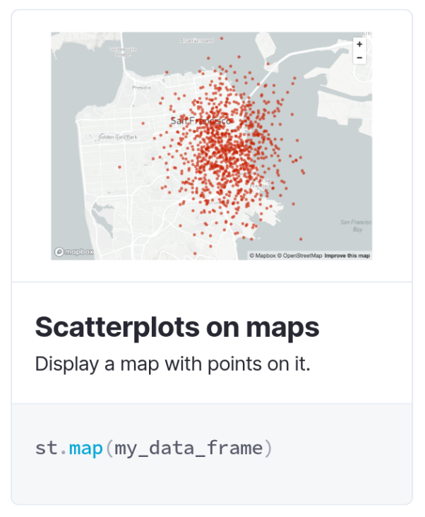

:::


## Supported chart libraries

We used `st.plotly_chart`, but there are several others...

::: {.api-images}

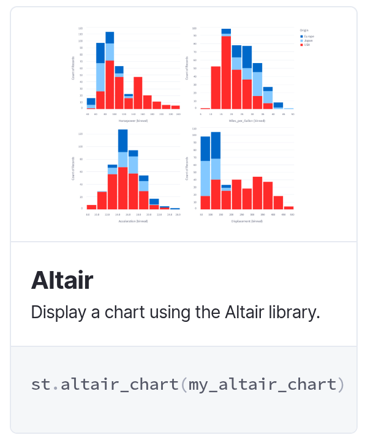
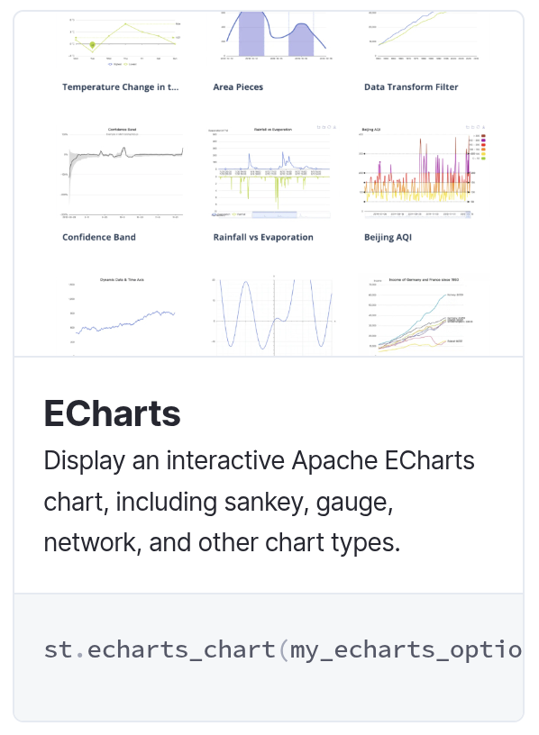
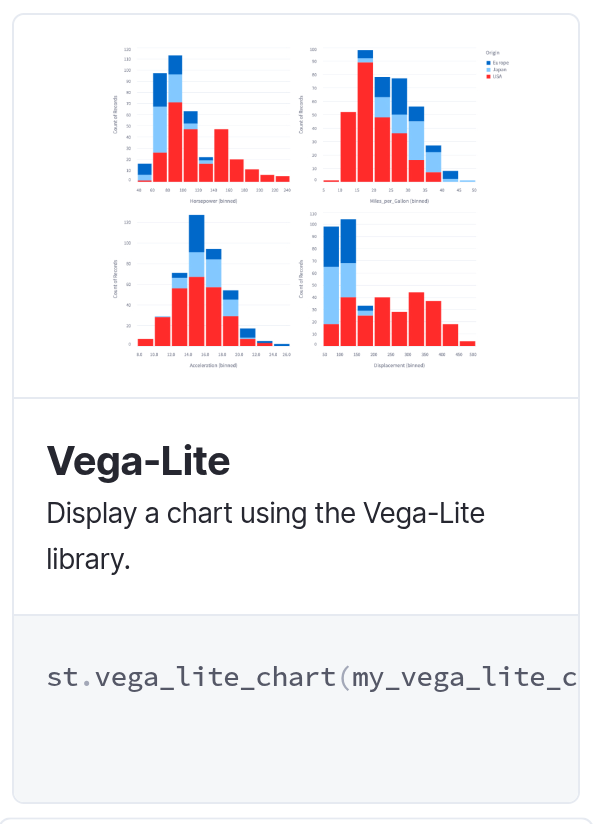
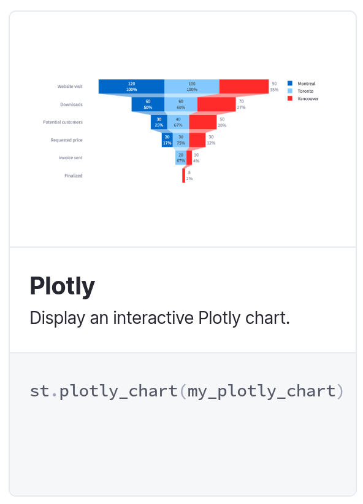

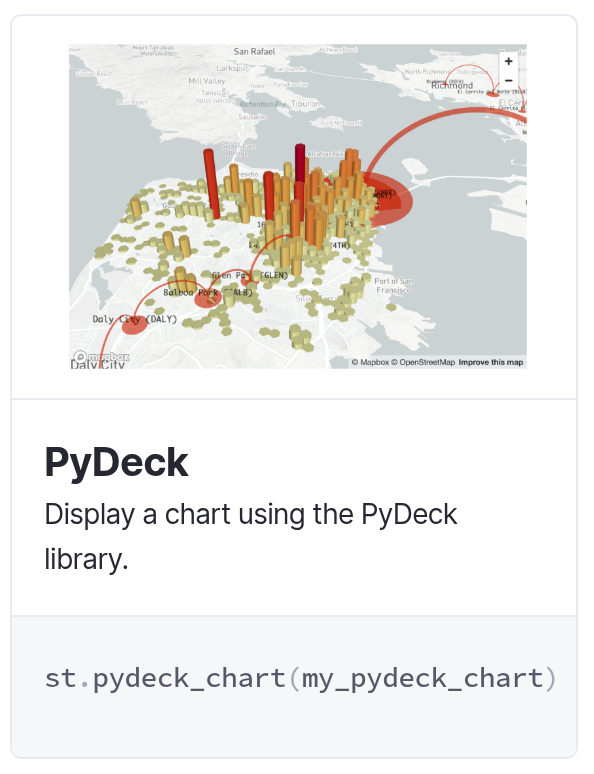
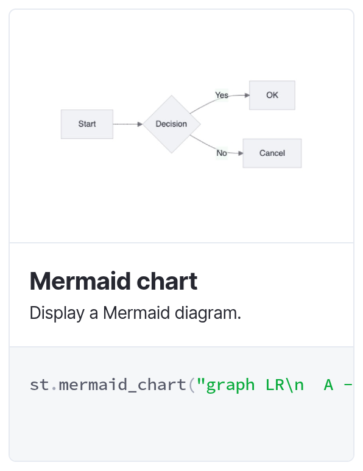
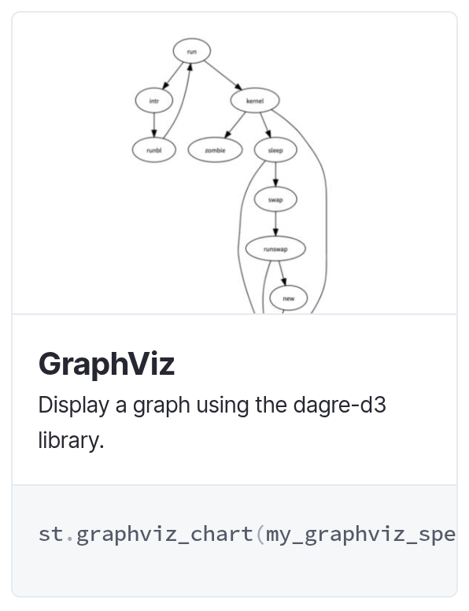
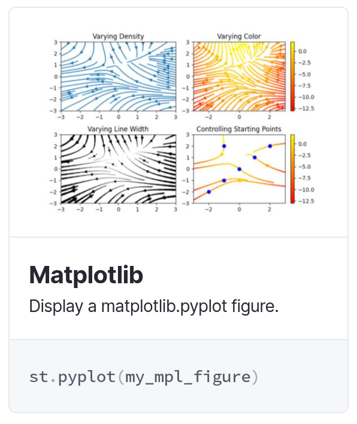

:::


## Maps

## `st.form`

## Other input widget types

::: {.api-images}

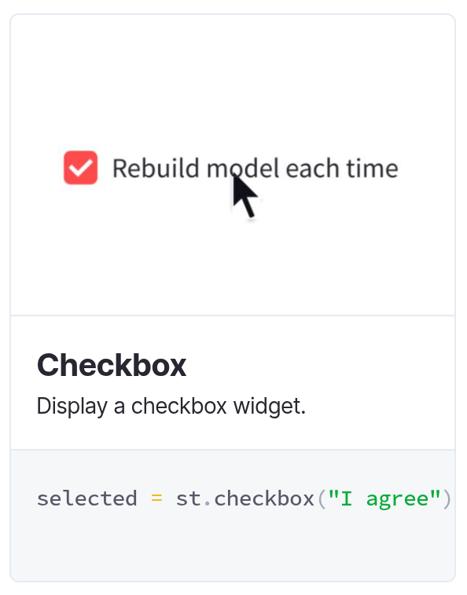
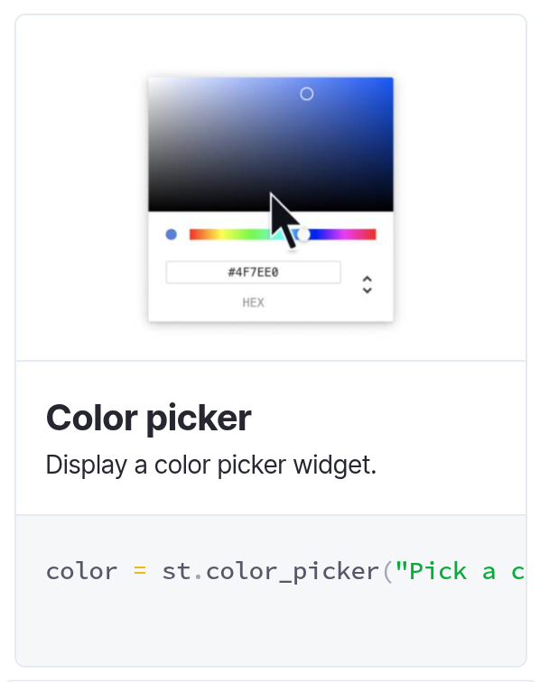
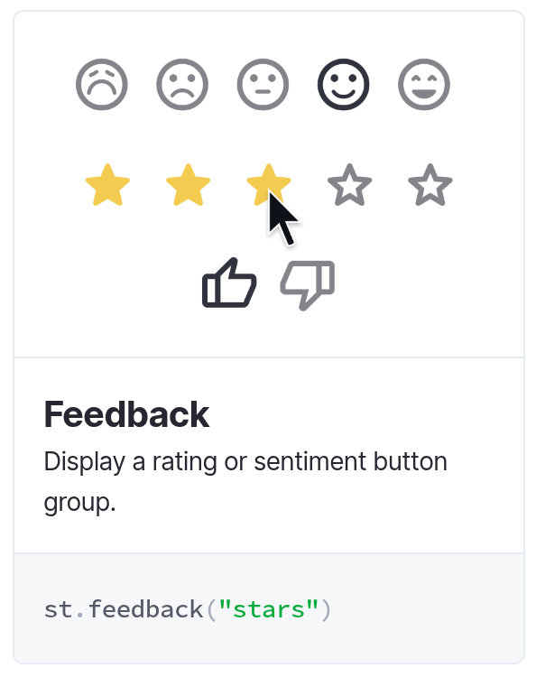

:::