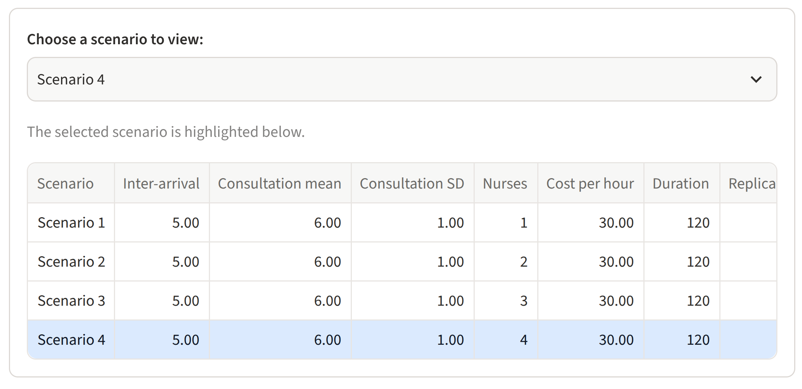
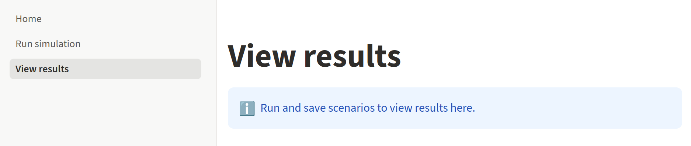
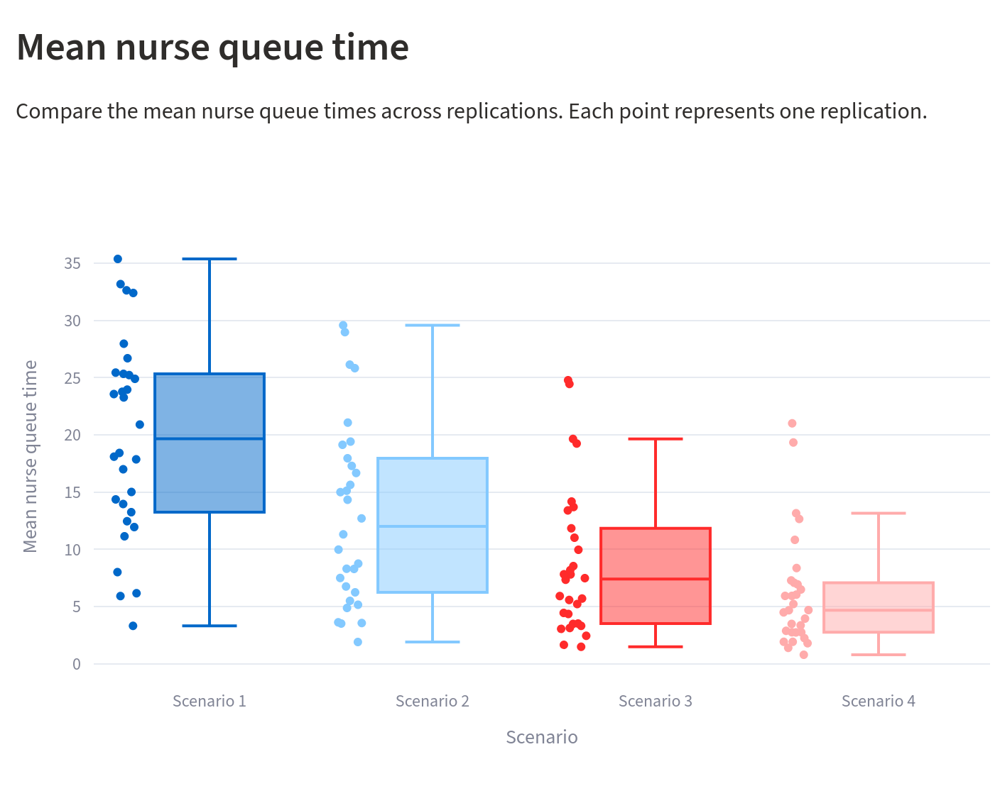

## 

<audio
  controls
  data-autoplay
  preload="auto"
  src="https://github.com/hsma-programme/hsma_assets/raw/refs/heads/main/h6_theme.mp3">
</audio>

:::: {.columns}

::: {.column width="55%"}

<div class="hsma-countdown"></div>

{height=250px}

::: {style="font-size: 21px; background-color: #31211d; border-radius: 16px; padding: 5px 0px;"}

**Module 2 'I want to fix my delays, and see what works before I try it'**

Session 2H: Creating a DES interface with Streamlit - Part 2

[Sammi Rosser - Presenter]{style="color: #7ac943;"}

[Amy Heather - Session content creator]{style="color: #7ac943;"}

[**And they all lived APPily every after**]{style="color: #ffe600;"}

:::

:::

::: {.column width="10%"}

:::

::: {.column width="35%"}

{width=300px}

{width=200px}

<br><br><br>

<iframe
  data-src="https://www.youtube.com/embed/AExH1e6SvZA?autoplay=1&mute=1&controls=0&loop=1&playlist=AExH1e6SvZA&enablejsapi=1"
  data-autoplay
  style="display: block; width: 100%; aspect-ratio: 16 / 9; border: 0;"
  allow="autoplay; encrypted-media; fullscreen"
  allowfullscreen>
</iframe>

:::

::::


## Reminder: App from the last session

<iframe
  src="https://hsma-des-multipage.streamlit.app/?embed=true"
  style="width: 100%; flex: 1; min-height: 0; border: 0;"
></iframe>


## Reminder: App from the last session

<a href="https://hsma-programme.github.io/hsma7_2g_streamlit_part1/app/multipage/" target="_blank">View stlite app in new tab</a>


# Scenarios


## Adding scenarios to our app

:::: {.columns}

::: {.column width="55%"}

<br>

A common use for a DES app is to compare scenarios with different inputs.

Our current app shows results for one run at a time. Changing the inputs and running again replaces the previous results.

:::

::: {.column width="5%"}

:::

::: {.column width="40%"}


:::

::::

::: {.fragment}

To compare scenarios, we need to:

1. **Save** each run's inputs and results.
2. Allow users to **view and compare** saved scenarios.

:::


## Preview: the app we will create

<iframe
  src="https://hsma-des-scenarios.streamlit.app/?embed=true"
  style="width: 100%; flex: 1; min-height: 0; border: 0;"
></iframe>


## Preview: the app we will create

<a href="https://hsma-programme.github.io/hsma7_2h_streamlit_part2/app/" target="_blank">View stlite app in new tab</a>


## Two pages: run scenarios and explore results

As shown, our app now splits the original simulation page into two:

* **Run simulation:** set inputs and run the model.
* **View results:** view results from a saved scenario or compare several.

<br>

::: {.fragment}

**Why?**

These pages support two different tasks: setting up simulations and making sense of their results. Users can move between them without having to do both in the same place.

This keeps the interface manageable if we add more inputs, results and comparison features.

:::


## New dictionary in session state

We first create an empty dictionary in session state, ready to store scenario results.

```{.python}

```

<br>

::: {.fragment}

We need to make sure it is only created it if it doesn't already exist.

This is because Streamlit reruns the script when users interact with the app. Without this check, each rerun would replace the dictionary with an empty one, clearing any saved results.

```{.python code-line-numbers="1"}

```

:::


## New dictionary in session state

:::: {.columns}

::: {.column width="50%"}

We'll initialise the dictionary in `app.py`, which runs before whichever page the user opens.

<br>

**Why not in `simulation.py?`**

Users might open the results page before running a simulation. If we created the dictionary only in `simulation.py`, it wouldn't exist yet, causing an error.

Putting this code in `app.py` ensures the dictionary exists before either page needs it.

:::

::: {.column width="50%"}

```{.python code-line-numbers="5-7"}

```

:::

::::


## Run and save the results

:::: {.columns}

::: {.column width="50%"}

In `simulation.py`, we'll keep the code that sets the inputs and runs the simulation.

We'll remove the analysis code for now and move it to the results page later. We can also remove `import plotly.express as px` as this page no longer uses it.

<br>

We'll add new code to:

1. Name the scenario

2. Save its settings and results in `st.session_state.scenarios`.

:::

::: {.column width="50%"}

```{.python code-line-numbers="79-100"}


```

:::

::::


## Run and save the results

:::: {.columns}

::: {.column width="50%"}

**Scenario names** are based on how many scenarios are already stored (e.g., "Scenario 1", "Scenario 2").

<br>

**Settings** record the inputs used for each scenario, so we can interpret and compare its results.

**Results** are the summary statistics, saved using shorter keys like `mean` and `sd` so they are easier to access later.

:::

::: {.column width="50%"}

```{.python code-line-numbers="false"}

```

:::

::::


## Run and save the results

We then set `chosen_scenario` to this scenario, making it the default selection when the user opens the results page.

We also show a success message to confirm that the scenario has run and its results have been saved.

<br>

```{.python code-line-numbers="false"}

```


## Keeping track of scenarios

We can also show a table of saved scenarios, so users can keep track of their runs.

This checks if `scenarios` is empty - and will only appear after the first scenario has been run.

We take the settings from each saved scenario and display them as a row in the table.

A caption reminds users that these scenarios are saved for the current session only.

<br>

```{.python code-line-numbers="false"}

```


## Linking to results page

At the end of `simulation.py`, we'll add a button linking to `results.py`, which we'll create next.

Clicking the button calls `st.switch_page` to take the user to the results page.

<br>

```{.python code-line-numbers="false"}

```


## Results from one scenario

:::: {.columns}

::: {.column width="50%"}

<br>

Now let's make the results page!

<br>

We'll start by moving the analysis code we removed earlier into a new file, `results.py`.

You can that code on the right.

<br>

However, we'll need to make some changes so it can work...

:::

::: {.column width="50%"}

```{.python code-line-numbers="false"}

```

:::

::::


## Required changes

:::: {.columns}

::: {.column width="50%"}

<br><br>

**1. Import the packages**

Import `pandas`, `plotly.express` and `streamlit` for this page.

:::

::: {.column width="50%"}

```{.python code-line-numbers="1-3"}

```

:::

::::


## Required changes

:::: {.columns}

::: {.column width="50%"}

<br><br>

**2. Retrieve the chosen scenario**

Use `chosen_scenario` to look up the saved scenario in `scenarios` and store it as `results`.

<br>

*For now, this is the most recently run scenario. We'll add a way for users to choose a different scenario in a moment.*

:::

::: {.column width="50%"}

```{.python code-line-numbers="5-6"}

```

:::

::::


## Required changes

:::: {.columns}

::: {.column width="50%"}

<br><br>

**3. Display the saved results**

Read the summary statistics and cost from `results`, rather than directly from the simulation `trial` object.

:::

::: {.column width="50%"}

```{.python code-line-numbers="13-21"}

```

:::

::::


## Required changes

:::: {.columns}

::: {.column width="50%"}

<br><br>
**4. Use saved data in histogram and table**

Use `results["df"]` as the data source for both the histogram and the table of individual replications.

:::

::: {.column width="50%"}

```{.python code-line-numbers="29,40"}

```

:::

::::


## Choose a scenario

Now we can let users choosen their `chosen_scenario` to view.

:::: {.columns}

::: {.column width="50%"}
We'll add:

* A dropdown to select a saved scenario.
* A table of scenario settings, so users can see what they're choosing between.
* A highlighted row showing the selected scenario.
:::

::: {.column width="50%"}

:::

::::


## Choose a scenario

:::: {.columns}

::: {.column width="50%"}

Let's work through the code to do that...

:::

::: {.column width="50%"}

```{.python}

```

:::

::::


## Choose a scenario

:::: {.columns}

::: {.column width="50%"}

<br><br>

**1. Use `st.container(border=True)`**

This keeps the scenario selection area visually separate from the results.

:::

::: {.column width="50%"}

```{.python code-line-numbers="1"}

```

:::

::::


## Choose a scenario

:::: {.columns}

::: {.column width="50%"}
<br><br>

**2. Select a scenario**

Use `st.selectbox()` to create a dropdown with the names of save scenarios.

Using `key="chosen_scenario"` means the selection is saved as and overwrites the last `chosen_scenario` in session state.

:::

::: {.column width="50%"}

```{.python code-line-numbers="2-6"}

```

:::

::::


## Choose a scenario

:::: {.columns}

::: {.column width="50%"}

<br><br>

**3. Create a settings dataframe**

Extract the settings dictionary for each saved scenario and combined them into a dataframe, with one row per scenario.

:::

::: {.column width="50%"}

```{.python code-line-numbers="8-14"}

```

:::

::::


## Choose a scenario

:::: {.columns}

::: {.column width="50%"}

<br><br>

**4. Display the settings dataframe**

Use `st.dataframe()` to display `settings`.

We'll write a function `style_settings()` which we can apply to the dataframe to highlight the chosen scenario row...

:::

::: {.column width="50%"}

```{.python code-line-numbers="16-24"}

```

:::

::::


## `style_settings()`

We'll write this function near the start of our `results.py` script.

It checks each row's scenario name against `chosen_scenarios`. Matching rows get a pale blue background. We use `.style.apply()` to apply this formatting row by row, then `.format(precision=2)` to display decimal values to two decimal places.

```{.python}

```


## No scenarios to view

Users might open the results page before running a scenario.

We'll show a message explaining that there are no saved results yet and directing them to run a scenario first.




## No scenarios to view

:::: {.columns}

::: {.column width="50%"}

We first check whether `scenarios` is empty.

If it is, we show a message using `st.info()`.

Otherwise, we display the results page as before.

:::

::: {.column width="50%"}

```{.python code-line-numbers="1-4"}

```

:::

::::

<br>

This avoids trying to display results when none are available.


## Creating tabs

:::: {.columns}

::: {.column width="50%"}

<br><br>

We have now finished the code for displaying results from one chosen scenario. Next, we'll add a way to compare several scenarios.

<br>

We'll use `st.tabs` to organise these two tasks within the results page:

* **View single scenario**
* **Compare scenarios**

:::

::: {.column width="50%"}


:::

::::


## Creating tabs

:::: {.columns}

::: {.column width="40%"}

We pass `st.tabs()` a list with titles for each tab.

<br>

It returns a container for each tab, which we assign to variables (here, `tab_single` and `tab_compare`).

<br>

We then use a `with` block to add content to each tab.

:::

::: {.column width="60%"}

```{.python code-line-numbers="11-15"}

```

:::

::::


## Choosing scenarios to compare

:::: {.columns}

::: {.column width="50%"}

<br><br><br>

On the “Compare scenarios” tab, we'll add a selection box where users can choose multiple saved scenarios.

If fewer than two scenario are run or selected, we'll show a messages asking them to run or select at least two.

:::

::: {.column width="50%"}


:::

::::


## Choosing scenarios to compare

:::: {.columns}

::: {.column width="50%"}

Let's work through the code to do that...

:::

::: {.column width="50%"}

```{.python}

```

:::

::::


## Choosing scenarios to compare

:::: {.columns}

::: {.column width="50%"}

<br><br>

**1. Use `tab_compare` and warn for insufficient scenarios**

If `scenarios` in session state only has zero or one saved scenarios, a message is displayed using `st.info()`.

:::

::: {.column width="50%"}

```{.python code-line-numbers="1-3"}

```

:::

::::


## Choosing scenarios to compare

:::: {.columns}

::: {.column width="50%"}

<br><br>

**2. Multiselect**

Once there are at least two scenarios, we set up a container and create `st.multiselect()`.

This is similar to `selectbox`, but allows users to choose multiple options at once.

:::

::: {.column width="50%"}

```{.python code-line-numbers="5-11"}

```

:::

::::


## Choosing scenarios to compare

:::: {.columns}

::: {.column width="50%"}

<br><br>

**3. Show saved scenarios**

Like before, we can show the saved scenarios and highlighted those selected using `style_settings()`.

:::

::: {.column width="50%"}

```{.python code-line-numbers="13-18"}

```

:::

::::


## Choosing scenarios to compare

:::: {.columns}

::: {.column width="50%"}

<br><br>

**4. Check chosen scenarios**

Show a message until at least two scenarios have been chosen. Then, results can be shown.

:::

::: {.column width="50%"}

```{.python code-line-numbers="20-24"}

```

:::

::::


## Boxplot

:::: {.columns}

::: {.column width="35%"}

<br><br><br><br>

Boxplots are a great option for comparing results across scenarios side by side.

They make it easy to see both the average results and the spread of results across replications.

:::

::: {.column width="65%"}



:::

::::


## Boxplot

:::: {.columns}

::: {.column width="50%"}

<br><br>

**1. Introduce figure**

We'll start by using `st.subheader()` and `st.write()` to introduce the figure and explain what it is showing.

:::

::: {.column width="50%"}

```{.python code-line-numbers="1-5"}

```

:::

::::


## Boxplot

:::: {.columns}

::: {.column width="50%"}

<br><br>

**2. Create single results dataframe**

Next, we use `pd.concat()` to stack the replication-level results from each scenario into a single dataframe called `replications`.

We also add a `Scenario` column to identify which scenario each row belongs to.

:::

::: {.column width="50%"}

```{.python code-line-numbers="7-14"}

```

:::

::::


## Boxplot

:::: {.columns}

::: {.column width="50%"}

**3. Create boxplot**

We create the figure using `plotly.express.box()`:

* `color`: group and color by scenario.
* `points`: show each replication as a dot.
* `category_orders`: keeps scenarios in the order they were saved.
* `hover_data`: include replication IDs.

It's displayed with `st.plotly_chart()`.

:::

::: {.column width="50%"}

```{.python code-line-numbers="16-32"}

```

:::

::::


## Comparison table

We could also use tables to compare results.

{height=450px}


## Comparison table

:::: {.columns}

::: {.column width="50%"}

<br><br>

**1. Construct summary table for nurse queue time**

Here, we are creating a table with the descriptive statistics from each scenario.

:::

::: {.column width="50%"}

```{.python code-line-numbers="4-21"}

```

:::

::::


## Comparison table

:::: {.columns}

::: {.column width="50%"}

<br><br>

**2. Display summary table**

We then display it using `st.dataframe()`, with `style.format()` to round the numbers.

`st.caption()` provides some helpful context.

:::

::: {.column width="50%"}

```{.python code-line-numbers="23-28"}

```

:::

::::


## Comparison table

:::: {.columns}

::: {.column width="50%"}

<br><br>

**3. Repeat for costs**

We can repeat this to show the nurse costs for each scenario. These are deterministic, just based on the number of resources in the simulation, so a single number is presented for each scenario.

:::

::: {.column width="50%"}

```{.python code-line-numbers="30-42"}

```

:::

::::


# Exercise 1


## Exercise 1

TODO
change app from yesterday from singlepage to multipage
with scenario comparison


# Hosting with stlite


## stlite

TODO


# Exercise 2


## Exercise 2

TODO
host your app with stlite


# Customising app appearance


## Customising app appearance

theme

css

logo

etc.

st.set_page_config

st.logo


# Exercise 3


## Exercise 3

TODO
customise appearance of your app
